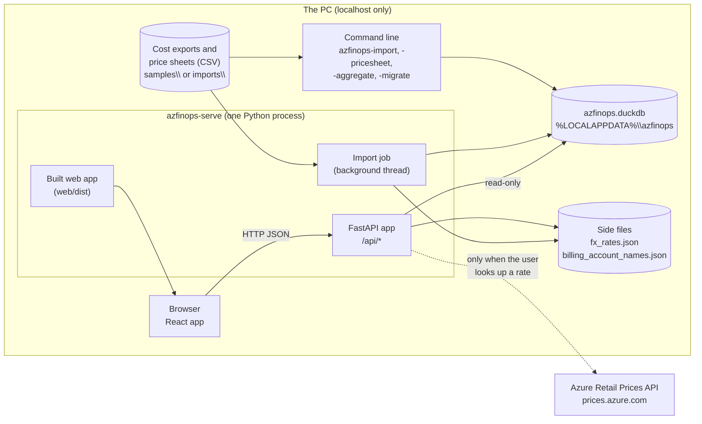
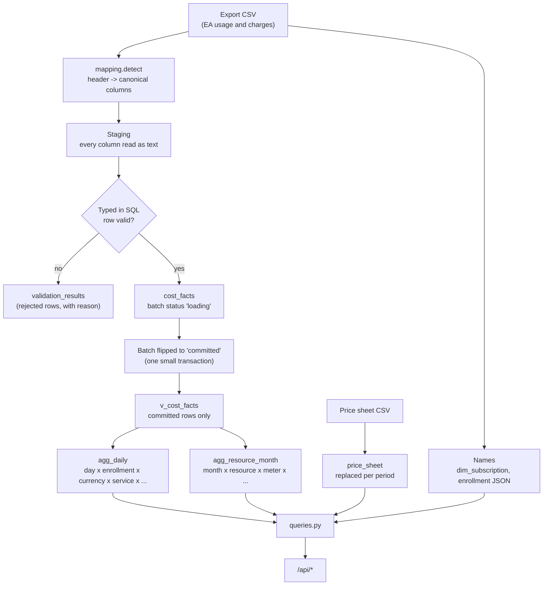
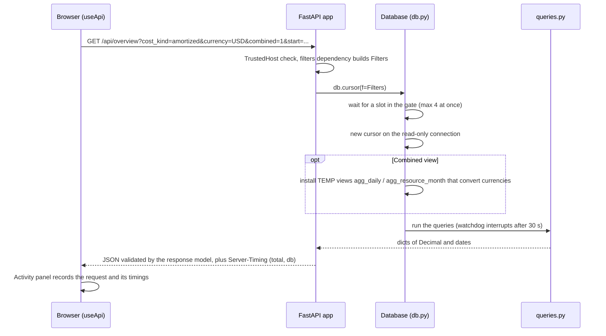
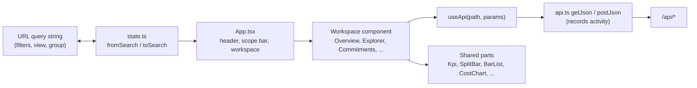
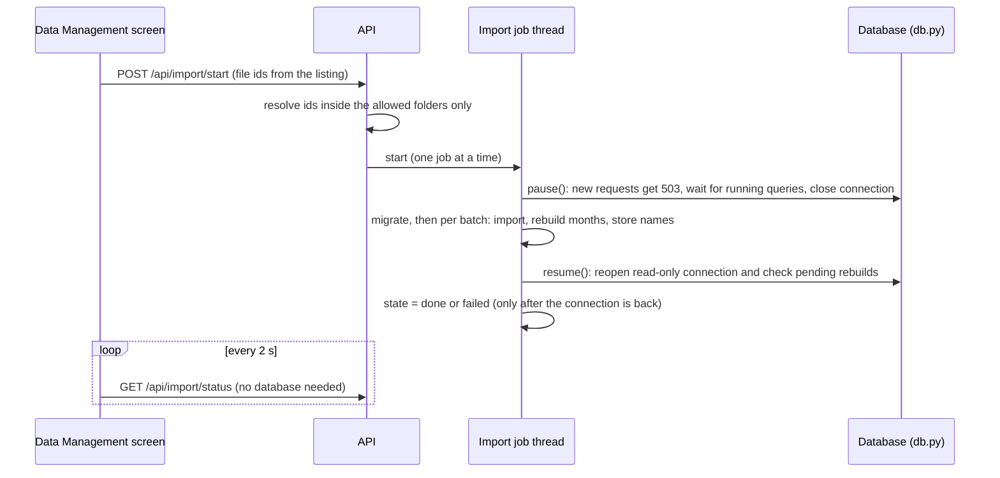

# Architecture

How the dashboard is put together and how its parts connect. For the rules contributors must follow see
`AGENTS.md`; for the screen conventions see `docs/design-system.md`; for how each figure is calculated see
`docs/methodology.md`; for every table and column see `docs/data-model.md`.

## In one paragraph

Everything runs on one Windows PC. Azure Enterprise Agreement cost exports (CSV) and price
sheets are loaded into a single **DuckDB** database file. Imports write exact, typed, signed rows into a fact table
in batches that only become visible when complete. From the facts, two **aggregate tables** are rebuilt per month;
analysis screens read those rather than scanning raw cost facts. Quality diagnostics also inspect facts.
A **FastAPI** server on
`127.0.0.1:8765` opens the database read-only and turns each request's filters into parameterised SQL. A **React**
single-page app, served by the same process, draws the results. The server makes one outbound call, the
exchange-rate lookup, and only when the user asks for it.

## System context



Two things can write to the database: the command-line tools, run with the server stopped, and the dashboard's
import job, which pauses the server's read-only connection while it writes. DuckDB allows one writer and no readers
while it writes, and the whole design follows from that (see "Who can write, and when").

## Code layout

```
src/azfinops/
  ingestion/       mapping.py (export columns -> canonical), importer.py (batches, rejects, supersede), __main__.py (CLI)
  migrations/      NNNN_*.sql (forward-only schema), runner.py (checksums, backup, apply)
  aggregates.py    month-partitioned rebuild of agg_daily and agg_resource_month
  queries.py       Filters, every dashboard query, definitions of each figure
  combined.py      Combined view: temp views that convert currencies at saved rates
  fx.py            exchange rates: lookup from the Retail Prices API, saved per month in a JSON file
  pricesheet.py    price sheet import (reference data, replaced per period)
  datamgmt.py      import history, data-quality checks, schema listing
  sqlbench.py      validation and bounded execution of the read-only SQL workbench
  jobs.py          imports started from the dashboard
  retention.py     atomic rolling 12-calendar-month purge, and preview/backed-up apply command
  dimensions.py    subscription names (dim_subscription)      accounts.py  enrollment names (JSON)
  workloads.py     meter categories grouped into AI / data / database families
  units.py         billing-unit normalisation for price comparison
  finance/calc.py  pure financial functions used by tests and the report
  report.py        plain-text reconciliation report         generator/   synthetic demo data
  config.py        Settings, all AZFINOPS_* environment variables
  api/
    app.py         routes, filters dependency, middleware, error handling
    db.py          read-only connection, request cursors, gate, timeouts, pause/resume
    schemas.py     Pydantic response models (the API contract)
    server.py      azfinops-serve
web/src/
  App.tsx          shell: header, scope bar, routing between workspaces, default filters
  api.ts           typed client, response types, filter -> query string, activity instrumentation
  state.ts         filters and view <-> URL        hooks.ts  useApi (fetch, cancel, retry)
  format.ts        money, percentages, periods     activity.ts  request log for the Activity panel
  components/      one file per workspace (Overview, Explorer, Spend, ...) plus shared cards and charts
tests/             pytest: one file per module or feature, small DuckDB fixtures
scripts/           setup and diagnostic scripts run against the real database
```

## The data pipeline



### Import (`ingestion/`)

1. **Detect the columns.** `mapping.detect` matches the export header against known aliases, so EA exports with
   different column names load the same way. Unknown columns are listed and ignored. By default `PayGPrice` is
   ignored and the contract `UnitPrice` becomes the baseline price (`payg_basis = 'contract'`).
2. **Refuse duplicates.** A file is identified by its SHA-256. An identical file already in a committed batch is
   refused unless `--reimport` (or "Allow the same file again") is given.
3. **Stage, then type.** Every column is read as text, then typed in SQL. A row that fails a rule (a bad date, a
   non-numeric cost) goes to `validation_results` with its reason, instead of becoming a zero. If more than the
   reject ratio (0.1% by default) fails, the whole batch is rolled back.
4. **Write as a batch.** Rows go into `cost_facts` under a new `import_batches` row with status `loading`, so
   queries can't see them yet. One final transaction flips the batch to `committed` and records pending
   month/basis rebuilds in `aggregate_invalidations`.
5. **Supersede.** With `--supersede`, committed batches for the same cost basis and overlapping period are marked
   superseded in the same transaction. Every enrollment/currency/date from each old batch must be present in
   the replacement; narrower replacements are refused rather than hiding unrelated periods or accounts.
6. **Retain 12 months.** In the same commit transaction, `retention.py` anchors a single portfolio-wide window to
   the newest committed cost month and keeps it plus the eleven preceding calendar months. Older `cost_facts`
   rows (including superseded copies), both aggregate tables and freshness/invalidation entries are deleted.
   Purge counts are recorded in `validation_results`, while original file/batch counts and hashes are preserved.
   An entirely expired export or future cost month is refused before it can commit or purge existing data.
   No CSV, reference price sheet, side file or backup is deleted. This applies to CLI and dashboard cost imports.
7. **Rebuild and name.** The retained months the batch touched are re-aggregated, and subscription and enrollment names are
   harvested from the file.

The retention policy requires no additional schema migration. For existing data, preview with
`uv run --no-sync python -m azfinops.retention`. With the server stopped, `--apply` acquires the writer,
backs up first without pruning existing backups, and purges in one transaction. If no rows are expired,
it makes no backup or deletion. Automatic import-time retention is part of the ingestion transaction and
does not copy the full database before every monthly import. Deleted storage can be reused by DuckDB;
the database file is not guaranteed to shrink.

### Aggregates (`aggregates.py`)

The aggregates are derived data and can be dropped and rebuilt at any time. Each month is rebuilt in its own
transaction, so a rebuild never leaves a month half-written. `aggregate_freshness` records when each month was
built and whether it covers every day.

`aggregate_scope_freshness` records the same coverage separately by enrollment, native currency, basis and month.
Period selection and comparisons require every selected scope to be complete, not just the union of their dates.
The metadata detects missing dates, not omitted partitions whose dates overlap supplied files.

Both tables and their scoped metadata are rebuilt in one month transaction. Only then is that month's pending
invalidation cleared. If rebuilding fails after an import commits, cost endpoints remain unavailable after
resume and after process restart. Diagnostics stay accessible; stop the server, run `azfinops-aggregate`, then
restart it to recover. A failed post-processing stage must never be described as a rolled-back import.

| Table | Grain | Used by |
|---|---|---|
| `agg_daily` | day × cost basis × enrollment × currency × service × charge type × pricing model × subscription × resource group × application × environment × region × meter sub-category … | Totals, charts, filters, commitments, movers, hourly savings-plan figures |
| `agg_resource_month` | month × resource × meter × charge type × pricing model × commitment … with first and last usage date and days used | Resource lists, reservations, savings headroom, rightsized and decommissioned resources |

Application and environment are worked out here from the tags (`AZFINOPS_APP_TAG_KEYS`, `AZFINOPS_ENV_TAG_KEYS`),
so changing a tag key needs only `azfinops-aggregate`, not a re-import.

### Reference data and side files

- **Price sheets** (`pricesheet.py` → `price_sheet`, `price_sheet_files`): imported per period and currency,
  separately from cost. Used by the pricing comparison and savings headroom.
- **Exchange rates** (`fx.py` → `fx_rates.json`): one rate per month and currency pair, looked up from the Retail
  Prices API or typed in. They are kept outside the database so that saving one never needs the single writer.
- **Enrollment names** (`accounts.py` → `billing_account_names.json`), for the same reason. Subscription names are
  in `dim_subscription`.

## How a request is answered



- **Filters.** One `filters` dependency in `app.py` turns the query string into a `Filters` object: cost basis,
  currency, combined, dates and the multi-select dimensions. `Filters.where()` produces the parameterised `WHERE`
  clause for `agg_daily`, and `_resource_where` does the same for `agg_resource_month`. Values are always parameters,
  never pasted into SQL.
- **Cursors.** Each request gets its own cursor from the shared read-only connection, a slot in a bounded gate, and a
  watchdog that interrupts it after `AZFINOPS_QUERY_TIMEOUT_S`. A full gate answers 503 rather than queueing without
  limit.
- **The Combined view.** For one request, `combined.install` creates TEMP views with the same names as the two
  aggregate tables. The queries run unchanged, but every money column of a foreign-currency row is multiplied by the
  saved rate for its month. A currency with no rate at all is left out and named in the response.
- **Exact FX arithmetic.** SQL DECIMAL(38,18) amounts and DECIMAL(24,18) rates are multiplied through a
  vectorized Arrow decimal256 function, then rescaled half-even to 18 places. NumPy is required by DuckDB's
  Arrow-function bridge; monetary arithmetic does not use NumPy floats. Rate discovery reads the small scoped
  metadata table, retaining all months for comparisons and the all-dates summary. Selected foreign daily money
  columns are cached per request; other dates still use the same exact converter. Resource-month conversion
  remains lazy. TEMP data and functions do not persist in the database file.
- **Responses.** Every route has a Pydantic response model (`schemas.py`), which is the contract between server and
  browser. Money is serialised as a string to keep it exact. Each derived figure carries a `definition`.
- **Quality checks.** `/api/data/quality` runs fast metadata/aggregate checks by default. `?full=true` explicitly
  enables raw fact-to-daily and daily-to-resource reconciliation; neither is labelled passed when skipped.
  The header uses only fast checks, and failed checks remain visible. Both modes retain the normal deadline.
- **Summary scans.** The all-dates strip derives cost, days and top services from one day/service rollup, preserving
  row-level exact conversion. Distinct resource/subscription counts read native IDs directly, applying the same
  saved-rate availability predicate without materialising converted money. Counts still exclude currencies with
  no usable rate. Equality tests compare the cost rollup with the previous three-scan implementation.

## The front end



- **State lives in the URL.** Filters, the workspace and the Explorer grouping are in the query string, so a view
  can be bookmarked or shared and the Back button works. On a bare address, `defaultFilters` opens the newest month
  every enrollment covers in full, in the Combined view when there is more than one currency.
- **Data fetching.** `useApi` fetches, cancels a stale request when the filters change, keeps the previous result on
  screen while the next one loads, and exposes `reload`. Lists below the Overview chart load only when they scroll
  into view (`LazyTop`), and the data-quality chip runs its checks a moment after the page loads.
- **Shared parts.** Cards, splits, charts and tables are shared components (see `docs/design-system.md`). Enrollment
  names and colours are registered once from `/api/meta` and used everywhere.
- **Build.** `npm run build` type-checks with `tsc` and bundles with Vite into `web/dist`, which `azfinops-serve`
  serves. There is no separate web server.

## Who can write, and when

| Writer | Writes | How it avoids the readers |
|---|---|---|
| `azfinops-import`, `-pricesheet`, `-aggregate`, `-migrate`, `-names` | The database | Run with the server stopped |
| Dashboard import job (`jobs.py`) | The database | Pauses the server's connection, then reopens it |
| Exchange rates, enrollment names | JSON files next to the database | Never touch the database |
| SQL workbench | Nothing | Read-only connection, one validated SELECT, row and time limits |

Migration 0010 adds scoped coverage and pending-rebuild metadata. The server reports an actionable startup
error for older schemas instead of guessing that cost data is current. Migration takes a backup first;
allow at least the database's size plus working headroom and stop the server before running it.

The import job, step by step:



If ingestion committed but rebuilding failed, the job reports `data_committed` and `recovery_required`.
`/api/meta` exposes the recovery message, and cost requests return 503 rather than old totals. Import history,
file listing, schema listing and quality diagnostics remain available; the SQL workbench is also blocked while
aggregates are stale.

## Security model

- **Network:** the server binds to `127.0.0.1` and checks the Host header, so it can't be reached from another
  machine or through DNS rebinding.
- **Writes:** every POST needs the `X-AzFinOps: 1` header, which a cross-site form can't send. The six actions are
  the SQL workbench, two exchange-rate actions, import start, budgets and saved views. A test fails if another appears.
- **Files:** dashboard imports read only from the allowed folders; the browser sends an id from the listing, never
  a path.
- **SQL:** the workbench runs on a read-only connection and accepts exactly one parsed SELECT, with row, size and
  time limits (`sqlbench.py`).
- **Outbound:** one fixed host and path prefix, with a timeout and size cap, only when the user clicks.
- **Migrations:** forward-only and checksummed, with a backup taken before any is applied.

## Configuration

All settings come from environment variables, read once by `Settings.from_env()`:

| Variable | Default | Controls |
|---|---|---|
| `AZFINOPS_DATA_DIR` | `%LOCALAPPDATA%\azfinops` | Where the database and side files live |
| `AZFINOPS_HOST`, `AZFINOPS_PORT` | `127.0.0.1`, `8765` | Where the server listens |
| `AZFINOPS_WEB_DIR` | `web/dist` | The built front end to serve |
| `AZFINOPS_MEMORY_LIMIT`, `AZFINOPS_THREADS` | `2GB`, `2` | DuckDB resources |
| `AZFINOPS_QUERY_TIMEOUT_S`, `AZFINOPS_MAX_CONCURRENT_QUERIES` | `30`, `4` | Request limits |
| `AZFINOPS_IMPORT_DIRS` | `<data dir>\imports` and the project's `samples` | Folders the dashboard may import from |
| `AZFINOPS_MAX_UPLOAD_MB` | `512` | Upload size limit |
| `AZFINOPS_APP_TAG_KEYS` | `mnd-applicationid,ApplicationID` | Tags that give a row its application |
| `AZFINOPS_ENV_TAG_KEYS` | `mnd-envtype` | Tags that give a row its environment |
| `AZFINOPS_USE_PAYG_PRICE` | off | Import `PayGPrice` as the baseline instead of `UnitPrice` |

## Testing

- **Python** (`tests/`, pytest): each test builds a small DuckDB with `migrate()` and either imports a fixture CSV
  (`tests/fixtures/`) or inserts rows directly, then checks hand-computed results. The API is tested end to end with
  FastAPI's `TestClient`, including the contract of which endpoints can write.
- **Front end** (`web/src/*.test.ts`, vitest): formatting, periods, URL state, CSV export, enrollment colours and the
  activity log.
- **On the PC:** the real database is checked with the Data Management quality checks, `azfinops-report` and the
  `scripts/diag_*.py` scripts, and reconciled against the Azure portal.

## Where to extend it

- **A new figure or screen:** a query in `queries.py`, a model in `schemas.py`, a route in `app.py`, a type in
  `api.ts`, a component, and its Knowledge entry. It works in the Combined view automatically if it reads the
  aggregates through `db.cursor(f=f)`.
- **A new filter or dimension:** a column in the aggregates (with a migration if it's new), then `Filters`,
  `DIMENSIONS` and the front end's `DIMS`.
- **A new data source:** a mapper into the canonical columns (`canonical.py`, `ingestion/mapping.py`), so
  everything downstream stays the same.

`AGENTS.md` lists the exact steps for each.
